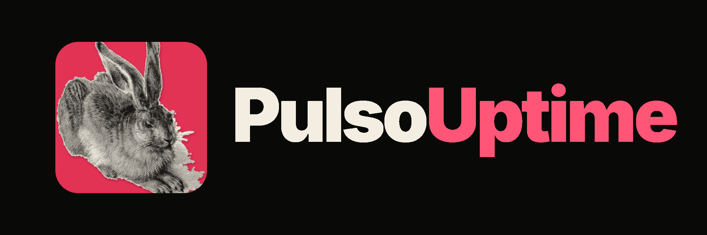
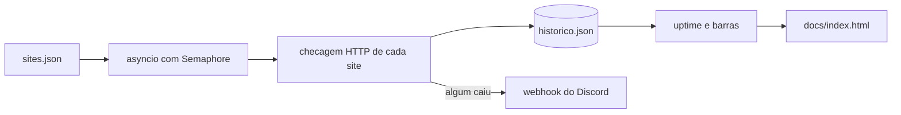

<p align="center"><sub>Pulso Uptime</sub></p>

---

<p align="center">
  
</p>

<p align="center">
  Monitor de disponibilidade com asyncio e página de status publicada pelo GitHub Actions
</p>

<p align="center">
  
  
  
  <a href="https://github.com/arthurlynow098/pulso-uptime/actions/workflows/testes.yml"></a>
</p>

## Sobre o projeto

Eu tenho alguns projetos publicados na Vercel (o portfólio, o LynowWorlds e o LynowMic) e mais de uma vez só descobri que algo tinha caído quando alguém me avisou. O Pulso resolve isso. Ele checa uma lista de sites, guarda o histórico, calcula o **uptime** e gera uma página de status estática, no estilo das que empresas grandes usam.

O melhor é que roda **de graça** dentro do GitHub Actions. Um workflow agendado faz a checagem a cada 6 horas e publica o resultado na pasta `docs/`, que o GitHub Pages serve como site.

<p align="center"></p>

## Como funciona



## Tecnologias

<p>
  
  
  
</p>

## Executando o código

Só precisa de Python 3.10 ou mais novo. Edite o `sites.json` com os seus endereços.

```json
{
  "sites": [
    { "name": "Portfólio", "url": "https://arthurentsev.vercel.app/" },
    { "name": "GitHub", "url": "https://github.com/arthurlynow098", "expect_text": "arthurlynow098" }
  ]
}
```

```bash
git clone https://github.com/arthurlynow098/pulso-uptime.git
cd pulso-uptime

# uma rodada
python -m pulso sites.json --pagina docs/index.html --historico docs/historico.json

# fica rodando a cada 5 minutos e avisa no Discord
python -m pulso sites.json --intervalo 300 --webhook https://discord.com/api/webhooks/...
```

Para publicar a página, ative o GitHub Pages do repositório apontando para a pasta `docs` da branch `main`. O workflow `status.yml` cuida do resto.

Testes (sobem um servidor HTTP local, não dependem de internet)

```bash
pip install -r requirements-dev.txt
python -m pytest -q
```

## Exemplo

```text
  UP   Portfólio                 413 ms   uptime  100.0%
  UP   LynowWorlds               434 ms   uptime  100.0%
  UP   LynowMic                  430 ms   uptime  100.0%
  UP   GitHub                    706 ms   uptime  100.0%

  página gerada em docs/index.html
```

## Estudei por aqui

Segui essas aulas e materiais para entender e aplicar tudo que está aqui.

| Material | O que tirei dele |
|---|---|
| [Documentação do asyncio](https://docs.python.org/3/library/asyncio.html) | `gather`, `Semaphore` e `to_thread` |
| [Google SRE Book, Monitoring Distributed Systems](https://sre.google/sre-book/monitoring-distributed-systems/) | O que vale a pena monitorar e como pensar em alertas |
| [TryHackMe, HTTP in Detail](https://tryhackme.com/room/httpindetail) | Códigos de status e o ciclo de uma requisição |
| [GitHub Pages](https://docs.github.com/en/pages/getting-started-with-github-pages) | Publicar a página gerada |

## Licença

Distribuído sob a licença MIT. Veja o arquivo [LICENSE](LICENSE).

<p align="center"><sub>A gravura do banner é a lebre de Albrecht Dürer, de 1502, em domínio público no <a href="https://commons.wikimedia.org/wiki/File%3AAlbrecht_D%C3%BCrer_-_Hare%2C_1502_-_Google_Art_Project.jpg">Wikimedia Commons</a>.</sub></p>
