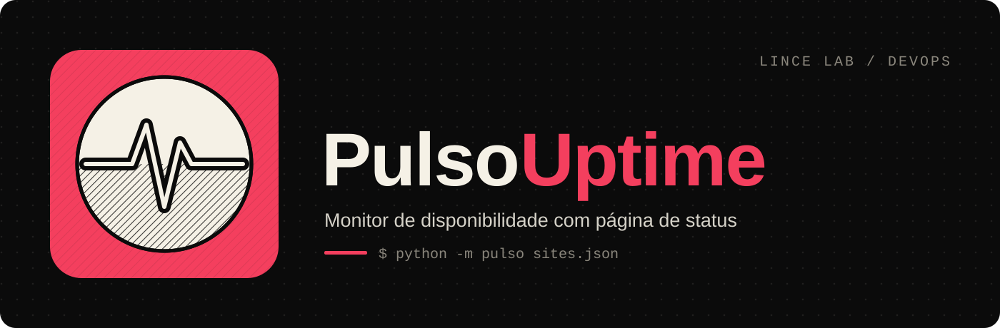
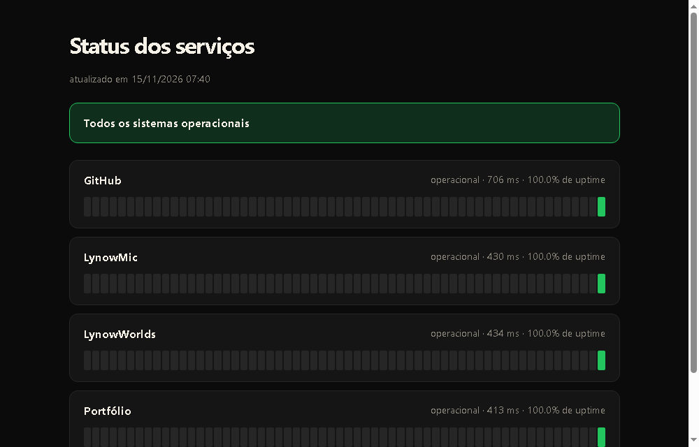
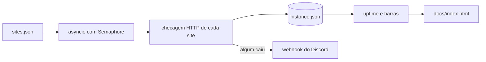

<a id="top"></a>

<p align="center"></p>

<p align="center">


<a href="https://github.com/arthurlynow098/pulso-uptime/actions/workflows/testes.yml"></a>
</p>

<p align="center"><a href="#sobre">Sobre</a> &nbsp;&nbsp; <a href="#como-funciona">Como funciona</a> &nbsp;&nbsp; <a href="#rodando">Rodando</a> &nbsp;&nbsp; <a href="#aprendi">O que aprendi</a> &nbsp;&nbsp; <a href="#estudos">Estudos</a></p>

<a id="sobre"></a>

<p></p>

Eu tenho alguns projetos publicados na Vercel (o portfólio, o LynowWorlds e o LynowMic) e mais de uma vez só descobri que algo tinha caído quando alguém me avisou. O Pulso resolve isso. Ele checa uma lista de sites, guarda o histórico, calcula o **uptime** e gera uma página de status estática, no estilo das que empresas grandes usam.

O melhor é que roda **de graça** dentro do GitHub Actions. Um workflow agendado faz a checagem a cada 6 horas e publica o resultado na pasta `docs/`, que o GitHub Pages serve como site.

<p align="center"></p>

<a id="como-funciona"></a>

<p></p>



| Recurso | Como fiz |
|---|---|
| **Checagem concorrente** | `asyncio.gather` com `asyncio.to_thread`, limitado por um `Semaphore` |
| **Validação** | Além do status HTTP, dá para exigir que um texto apareça na página. Pega o caso em que o servidor responde 200 mas com página de erro |
| **Histórico** | As últimas 500 checagens de cada site em JSON |
| **Página de status** | HTML estático, sem JavaScript, com barras coloridas por checagem. Todo texto passa por `html.escape` |
| **Alerta** | Se algum site cair, manda mensagem para um webhook do Discord |
| **Agendamento** | Workflow do GitHub Actions com `cron` que roda e faz commit do resultado |

No [Lince Portscan](https://github.com/arthurlynow098/lince-portscan) eu usei threads para concorrência. Aqui usei asyncio de propósito, para comparar os dois jeitos.

<a id="rodando"></a>

<p></p>

Só precisa de Python 3.10 ou mais novo. Edite o `sites.json` com os seus endereços.

```json
{
  "sites": [
    { "name": "Portfólio", "url": "https://arthurentsev.vercel.app/" },
    { "name": "GitHub", "url": "https://github.com/arthurlynow098", "expect_text": "arthurlynow098" }
  ]
}
```

```bash
git clone https://github.com/arthurlynow098/pulso-uptime.git
cd pulso-uptime

# uma rodada
python -m pulso sites.json --pagina docs/index.html --historico docs/historico.json

# fica rodando a cada 5 minutos e avisa no Discord
python -m pulso sites.json --intervalo 300 --webhook https://discord.com/api/webhooks/...
```

Para publicar a página, ative o GitHub Pages do repositório apontando para a pasta `docs` da branch `main`. O workflow `status.yml` cuida do resto.

Testes (sobem um servidor HTTP local, não dependem de internet)

```bash
pip install -r requirements-dev.txt
python -m pytest -q
```

<p></p>

```text
  UP   Portfólio                 413 ms   uptime  100.0%
  UP   LynowWorlds               434 ms   uptime  100.0%
  UP   LynowMic                  430 ms   uptime  100.0%
  UP   GitHub                    706 ms   uptime  100.0%

  página gerada em docs/index.html
```

<a id="aprendi"></a>

<p></p>

- A diferença prática entre threads e asyncio para trabalho de rede
- Limitar concorrência com `Semaphore` para não derrubar o próprio alvo
- Usar GitHub Actions como servidor agendado gratuito
- Gerar HTML estático com segurança, escapando tudo que vem de configuração
- O que é uptime de verdade e por que "200 OK" nem sempre quer dizer que o site está bem

Próximos passos

- [ ] Checar a validade do certificado TLS e avisar 15 dias antes de vencer
- [ ] Gráfico de latência ao longo do tempo
- [ ] Suporte a Telegram e e-mail além do Discord

<a id="estudos"></a>

<p></p>

Segui essas aulas e materiais para entender e aplicar tudo que está aqui.

| Material | O que tirei dele |
|---|---|
| [Documentação do asyncio](https://docs.python.org/3/library/asyncio.html) | `gather`, `Semaphore` e `to_thread` |
| [Google SRE Book, Monitoring Distributed Systems](https://sre.google/sre-book/monitoring-distributed-systems/) | O que vale a pena monitorar e como pensar em alertas |
| [TryHackMe, HTTP in Detail](https://tryhackme.com/room/httpindetail) | Códigos de status e o ciclo de uma requisição |
| [GitHub Pages](https://docs.github.com/en/pages/getting-started-with-github-pages) | Publicar a página gerada |

<p align="center"><sub>Parte do <a href="https://github.com/arthurlynow098">Lince Lab</a>, minha coleção de projetos</sub></p>

<p align="center"><a href="#top">Voltar ao topo</a></p>
